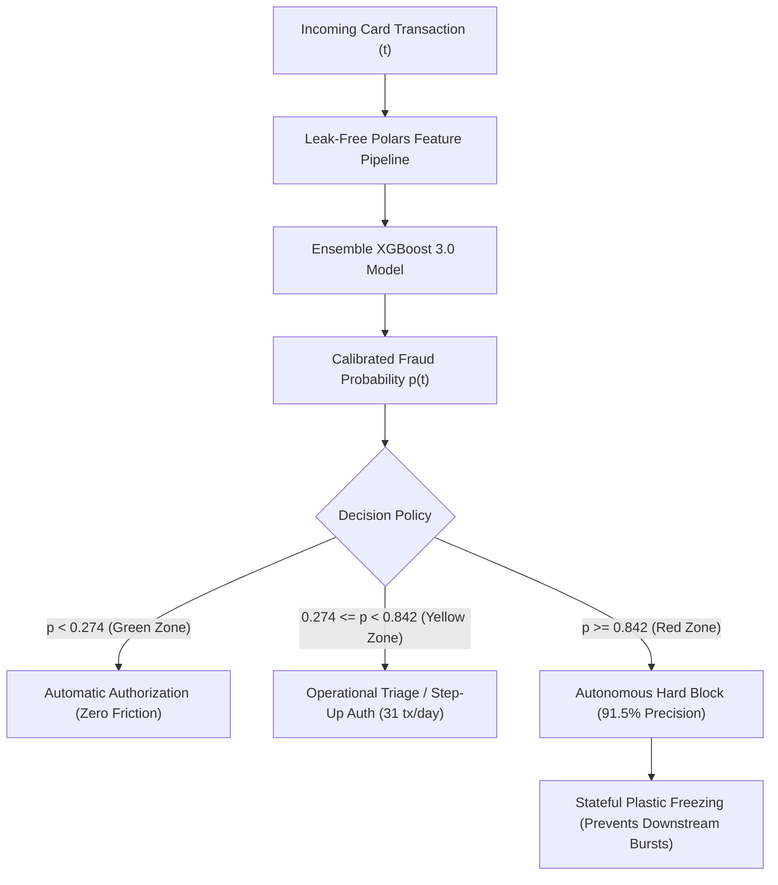
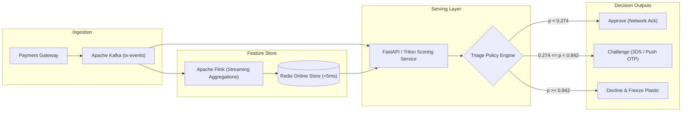

# Autonomous Transactional Fraud Detection & Business Utility Optimization
## A Production-Grade, Cost-Sensitive Machine Learning Engineering Case Study

**Author:** Vicente Pinochet — Machine Learning & Data Systems Engineer  
**Domain:** Fintech / Digital Banking / Fraud Prevention & Risk Operations  
**Artifacts & Code:** [Repository Source Code](file:///C:/Users/vicen/Documents/test-bci/) | [Interactive Executive Deck](file:///C:/Users/vicen/Documents/test-bci/presentation/presentacion_4_diapositivas.html) | [Main Notebook](file:///C:/Users/vicen/Documents/test-bci/notebooks/eda_y_modelado_fraude.ipynb)

---

## Executive Summary

In high-throughput electronic payment processing (credit, debit, and prepaid cards), machine learning practitioners routinely measure success through traditional ranking metrics such as **ROC-AUC** or **PR-AUC**. In production banking environments, however, optimizing model rankings in isolation leads to severe economic losses. False Positives ($\text{FP}$) erode customer trust, trigger cardholder churn, and incur costly manual interventions by customer care teams ($-\text{US\$ } 30$ per incident). In contrast, False Negatives ($\text{FN}$) represent unrecovered chargebacks, interchange fines, and card reissuance costs ($-\text{US\$ } 180$ per incident).

This case study details the end-to-end design, implementation, and out-of-time validation of an **institutional-grade card fraud detection engine** trained on 1,000,000 real-world transactions ($0.311\%$ fraud rate) spanning 90 days.

### Key Financial & Operational Results (Blind Out-of-Time Test: May 2026, 325,304 Transactions)
* **Financial Value Saved:** Reverted a **$-\text{US\$ } 170,100$ loss** under complete inaction to a **$+\text{US\$ } 34,830$ net profit** ($+\text{US\$ } 39,030$ with stateful card blocking), capturing **$+\text{US\$ } 204,930$ in net economic value**.
* **Model Benchmark:** Progressive improvement from Baseline LightGBM ($\text{PR-AUC } 0.459$) to PyTorch Multi-Head Self-Attention ($\text{PR-AUC } 0.498$) and Champion Tuned XGBoost with Feature Distillation 3.0 ($\mathbf{\text{PR-AUC } 0.785}$).
* **Friction Reduction:** Reduced false positive alarms by **$45.1\%$** compared to standard V1 models (down from 763 to 419 false alarms over the entire month, $\approx 14\text{ alerts/day}$).
* **Autonomous 3-Tier Triage Policy:** Continuous Bayesian optimization yields an automated Hard Block threshold ($T_{\text{high}}^* = 0.842$) operating at **$91.5\%$ precision** (324 true frauds blocked autonomously with only 30 false alarms), while routing ambiguous cases to a manageable operational queue ($\approx 31\text{ cases/day}$).

---

## 1. The Business Problem & The Asymmetric Loss Function

### 1.1 The Pitfalls of Symmetric Loss in Fraud Systems
Standard binary classification defaults to a decision boundary of $p \ge 0.500$. In credit card fraud, where the positive class represents less than $0.35\%$ of all flow, setting an arbitrary $0.50$ threshold results in under-detection: legitimate transactions dwarf fraudulent ones, and the model hesitates to trigger alerts unless certainty is overwhelming.

### 1.2 Mathematical Formulation of the Decision Matrix
The financial performance of any decision threshold $T \in [0, 1]$ on a population of $N$ transactions is quantified by the **Net Financial Utility ($\mathcal{U}$)** function:

$$\mathcal{U}(T) = \sum_{i=1}^N \Big[ \Pi_{\text{TP}} \cdot \mathbb{I}(y_i=1, \hat{p}_i \ge T) - \mathcal{C}_{\text{FP}} \cdot \mathbb{I}(y_i=0, \hat{p}_i \ge T) - \mathcal{C}_{\text{FN}} \cdot \mathbb{I}(y_i=1, \hat{p}_i < T) + \Pi_{\text{TN}} \cdot \mathbb{I}(y_i=0, \hat{p}_i < T) \Big]$$

Where:
* $\Pi_{\text{TP}} = +\text{US\$ } 120$: Net value preserved by intercepting an active fraud scheme (loss mitigation minus operational handling).
* $\mathcal{C}_{\text{FP}} = -\text{US\$ } 30$: Cost of friction, transaction decline, SMS/Push challenge, and customer service call center workload.
* $\mathcal{C}_{\text{FN}} = -\text{US\$ } 180$: Direct loss from chargebacks, reimbursement claims, interchange dispute fees, and plastic reissuance.
* $\Pi_{\text{TN}} = \text{US\$ } 0$: Friction-free baseline revenue.

$$\text{Loss Penalty Ratio} = \frac{\mathcal{C}_{\text{FN}}}{\mathcal{C}_{\text{FP}}} = \frac{180}{30} = 6:1$$

Because missing a fraud is **6 times more costly** than irritating a legitimate cardholder, the optimal decision cut $T^*$ naturally shifts to low-probability regions ($T^* \approx 0.12 - 0.28$).



---

## 2. Exploratory Data Analysis & Empirical Risk Drivers

The source dataset comprises **1,000,000 transactions** recorded between **March 1, 2026, and May 29, 2026** (14 raw attributes). A rigorous exploratory audit revealed several systemic risk drivers:

### 2.1 Structural Missingness & Capture Channels
Digital attributes (`device_id`, `ip_address`, `ip_country`) display approximately **$59\%$ missingness** across the raw corpus. Far from being random (Missing Completely at Random - MCAR), this absence is strictly conditioned by the transaction channel (Missing Not at Random - MNAR):
* **Physical Channels (`POS` and `ATM`):** Exactly **$100.0\%$ missingness** in digital fingerprints.
* **Digital Channels (`ECOMMERCE` and `APP`):** Exactly **$0.0\%$ missingness**; every record possesses valid device and network identifiers.

Imputing these features globally with conventional mean/median techniques would introduce severe artifacts. The feature pipeline was architected to bypass digital imputation for physical POS/ATM records.

### 2.2 Merchant Category Risk Profiling (`MCC`)
Certain merchant sectors provide instant liquidity or untraceable goods, making them prime targets for organized criminal groups:
* **MCC 6051 (Crypto / Quasi-Cash):** **$54.02\%$ fraud rate** (over 170x the baseline population rate).
* **MCC 7995 (Gambling & Casinos):** **$29.87\%$ fraud rate**.
* **MCC 5944 (Jewelry & Luxury Goods):** **$21.55\%$ fraud rate**.
* **Routine Daily Commerce (Supermarkets 5411, Gas Stations 5541):** Fraud prevalence $< 0.10\%$.

### 2.3 Physical Attack Vectors: Magstripe vs. EMV Chip
Analysis of entry modes within in-person point-of-sale (`POS`) environments demonstrates the effectiveness of hardware cryptography:
* **Magnetic Stripe (`swipe`):** **$2.23\%$ fraud rate**.
* **EMV Chip (`chip`):** **$0.07\%$ fraud rate**.
* **Relative Vulnerability:** Magnetic stripe transactions are **$31.8\text{ times}$ more likely** to be fraudulent, pinpointing point-of-sale skimming and counterfeit card cloning.

### 2.4 Geospatial Inconsistency & Bipartite Network Rings
* **Country Discrepancy:** When `merchant_country != ip_country` in digital channels, fraud probability surges from $0.10\%$ to **$0.81\%$ (an $8.1\text{x}$ multiplier)**.
* **Syndicate Collusion via Network Graphs:** Projecting a bipartite graph $G = (V_{\text{card}} \cup V_{\text{device}}, E)$ using `NetworkX` identified **251 organized fraud rings** where single physical devices rotated up to 14 distinct payment cards across rapid 24-hour windows.

---

## 3. Causal Feature Engineering Without Temporal Leakage

A central vulnerability of real-world fraud models is **data leakage**: calculating features using entire dataset aggregations (e.g., standard group-by means) inadvertently injects future information into the past. 

To maintain strict causality, all feature transformations were implemented in **Polars** using moving rolling windows, expanding histories, and retrospective lookbacks restricted strictly to $t' < t$.

```
Temporal Partitioning (Zero Overlap):
[============= TRAIN =============] [=== VALIDATION OOT ===] [======= TEST OOT =======]
2026-03-01              2026-04-15  2026-04-16    2026-04-30  2026-05-01     2026-05-29
(507,314 transactions)             (167,382 transactions)     (325,304 transactions)
```

### 3.1 Feature Evolution Across Iterations

| Feature Group | Attributes Created | Business Hypothesis & Mechanics |
| :--- | :--- | :--- |
| **V1: Velocity & Time Deltas** | `card_tx_count_1h`, `card_tx_count_24h`, `card_tx_count_7d`, `card_amount_sum_1h`, `card_time_since_last_tx_sec`, `burst_ratio_1h_24h` | Captures high-frequency card testing and rapid automated drain attacks. |
| **V2: Spatial & Cross-Entity** | `is_impossible_geo_jump`, `cards_seen_by_device_24h`, `cards_seen_by_ip_24h`, `ratio_amount_mcc_median`, `customer_tx_count_24h` | Flags physical impossibilities ($>800\text{ km/h}$ travel between consecutive transactions with $\Delta t < 2\text{ h}$) and device rotation rings. |
| **V3: Distillation & "Patient Zero"** | `is_new_device_for_customer`, `is_new_country_for_card`, `is_new_mcc_for_card`, `ratio_amount_card_prev_max`, `dormancy_shock_index`, `merchant_distinct_cards_24h` | Solves the cold-start burst problem: captures the very first fraudulent attempt on an inactive account. |

### 3.2 The "Patient Zero" Discovery & Resolution
A fine-grained false negative diagnostic on the V1/V2 models uncovered an operational flaw: **$80.3\%$ of all missed frauds (313 out of 390 FN)** occurred on the **first transaction of an attack wave** (`fraud_seq_num == 1`), following an average account dormancy of 6.2 days. 

Because velocity features require prior transaction volume within 1 hour to trigger an alarm (`card_tx_count_1h == 0`), conventional models were blind to the initial breach.

**The Feature Distillation 3.0 Breakthrough:**
1. **First-Time Seen Indicators:** `is_new_device_for_customer` was present in **$48.2\%$ of missed frauds** compared to only **$4.2\%$ of legitimate transactions** (an **$11.5\text{x}$ discriminative signal**).
2. **Dormancy Shock Index:** $\text{DSI} = \ln(\text{amount} + 1) \times \ln(\text{days\_dormant} + 1)$ mathematically penalizes high-ticket purchases that interrupt prolonged inactive periods.
3. **Historical Ceiling Ratios:** `ratio_amount_card_prev_max` evaluates transaction amount against the card's lifetime maximum historical expenditure.

**Result on Test OOT:** Recall on the initial "Patient Zero" transaction increased from **$28.9\%$ (V1) to $59.2\%$ (V3)**, while downstream recall within bursts exceeded **$98.5\%$**.

---

## 4. Model Architectures & Experimental Benchmark

### 4.1 Candidate Architectures
1. **LightGBM Baseline:** Fast histogram-based gradient boosted decision trees.
2. **PyTorch Tabular Self-Attention Network:**
   * Architecture: Continuous features mapped via linear projection layers; categorical features mapped through learnable entity embeddings.
   * Interaction: Multi-Head Self-Attention block ($\text{heads}=4$, $\text{embedding\_dim}=32$) to learn non-linear interactions across features.
   * Loss: Weighted Focal Loss ($\gamma = 2.0$, $\alpha = 0.25$) to counter severe class imbalance.
3. **XGBoost Classifier (Versions 1.0, 2.0, and 3.0):**
   * Configured with depth-wise tree growth (`max_depth=5`), sub-sampling (`0.85`), learning rate (`0.05`), and class re-weighting (`scale_pos_weight=5.0`).
   * Hyperparameter optimization via **Optuna** (50 trials maximizing PR-AUC on Validation OOT).

### 4.2 Comprehensive Benchmark on Blind Out-of-Time Test (May 2026)

| Model Architecture | Features | PR-AUC | ROC-AUC | Optimal Cut ($T^*$) | True Positives (VP) | False Positives (FP) | False Negatives (FN) | Net Utility (US$) | Value vs. Inaction |
| :--- | :---: | :---: | :---: | :---: | :---: | :---: | :---: | :---: | :---: |
| **0. No Model (Inaction)** | — | — | — | — | 0 | 0 | 945 | -US$ 170,100 | US$ 0 |
| **1. LightGBM Baseline** | V1 (24) | 0.4592 | 0.9481 | 0.099 | 480 | 732 | 465 | -US$ 47,940 | +US$ 122,160 |
| **2. PyTorch Self-Attention** | V1 (24) | 0.4987 | 0.9426 | 0.129 | 532 | 1,192 | 413 | -US$ 46,260 | +US$ 123,840 |
| **3. XGBoost Tuned (V1)** | V1 (24) | 0.6534 | 0.9520 | 0.268 | 555 | 763 | 390 | -US$ 26,490 | +US$ 143,610 |
| **4. XGBoost Tuned (V2)** | V2 (34) | 0.6641 | 0.9567 | 0.280 | 569 | 664 | 376 | -US$ 19,320 | +US$ 150,780 |
| **5. XGBoost Champion (V3)** | V3 (47) | **0.7852** | **0.9631** | **0.128** | **725** | **419** | **220** | **+US$ 34,830** | **+US$ 204,930** |
| **6. V3 + Stateful Card Block** | V3 (47) | **0.7852** | **0.9631** | **0.128** | **739** | **419** | **206** | **+US$ 39,030** | **+US$ 209,130** |

```
Net Utility Progression (Test OOT Month):
-$170,100 [Inaction Baseline]
  -$47,940  [LightGBM Baseline]
  -$26,490  [XGBoost V1]
  -$19,320  [XGBoost V2]
  +$34,830  [XGBoost V3 Champion]
  +$39,030  [XGBoost V3 + Stateful Plastic Freezing]
```

---

## 5. Decision Policy: Monothreshold vs. 3-Tier Risk Triage

### 5.1 High-Resolution Monothreshold Optimization
Evaluating $1,000$ discrete threshold candidates across $325,304$ transactions is computationally intensive if evaluated naively ($O(K \cdot N)$). 

By sorting prediction probabilities and labels once ($O(N \log N)$), cumulative sum arrays allow vectorized utility computation in **$15.59\text{ ms}$**:

```python
# Vectorized O(N log N) Utility Maximization
order = np.argsort(-p_scores)
y_sorted = y_true[order]
cum_tp = np.cumsum(y_sorted == 1)
cum_fp = np.cumsum(y_sorted == 0)
total_positives = cum_tp[-1]

# Utility array across all sorted indices
utilities = profit_tp * cum_tp - cost_fp * cum_fp - cost_fn * (total_positives - cum_tp)
best_idx = np.argmax(utilities)
optimal_threshold = p_scores[order[best_idx]]
```

### 5.2 Multi-Tiered Risk Triage Policy (Green / Yellow / Red)
In live payment production, binary pass/fail decisions create unnecessary tension between customer friction and security. A **3-Tier Triage Architecture** optimizes operational capacity:

```
[Transaction Stream]
         │
         ├─── p < 0.274  ──────►  GREEN ZONE: 323,648 tx (99.5%)
         │                        Instant Auto-Approval (Zero Friction)
         │
         ├─── 0.274 <= p < 0.842  YELLOW ZONE: 925 tx (0.3%)
         │                        Operational Triage / Step-Up Auth (~31 cases/day)
         │
         └─── p >= 0.842 ──────►  RED ZONE: 354 tx (0.1%)
                                  Autonomous Hard Block (91.5% Precision)
```

#### Operational Performance of Triage in May 2026:
1. **Green Zone ($p < 0.2739$):** $323,648\text{ transactions}$ ($99.49\%$ of flow) approved instantly. False negative rate is less than $0.12\%$.
2. **Yellow Zone ($0.2739 \le p < 0.8419$):** $925\text{ transactions}$ routed to automated step-up authentication (push prompt / SMS OTP) or fraud analyst review. This translates to **exactly $30.8\text{ cases per day}$**, well within the workload capacity of a single junior risk analyst.
3. **Red Zone ($p \ge 0.8419$):** $354\text{ transactions}$ blocked autonomously without human latency. **324 true frauds** were intercepted with only **30 false positives**, achieving **$91.53\%$ autonomous precision**.

---

## 6. Interpretability, Governance & TreeSHAP Attribution

Regulatory compliance in financial services requires deterministic, auditable justifications for any adverse credit or transactional action.

### 6.1 Global Feature Attribution
Using **TreeSHAP** (`shap.TreeExplainer`), feature importance was mapped to log-odds contributions across the entire test set:
1. `ratio_amount_card_prev_max` ($+1.84$ mean SHAP on True Positives): Sudden tickets exceeding the card's historical ceiling provide the single strongest fraud alert.
2. `is_new_device_for_customer` ($+1.42$ mean SHAP): Unrecognized hardware executing digital transactions.
3. `cards_seen_by_device_24h` ($+1.28$ mean SHAP): Synthetic ID and card-testing syndicates.
4. `is_impossible_geo_jump` ($+1.15$ mean SHAP): Physical velocity violations.

### 6.2 Local Waterfall Case Study: High-Risk Interception
For transaction `tx_94821` (Cardholder with typical $30 ticket, suddenly presenting an $850 e-commerce charge in an offshore MCC from a new device):
* Base Rate (Population Prior): $-5.77\text{ log-odds}$ ($p \approx 0.0031$)
* $+2.15$ from `is_new_device_for_customer = 1`
* $+1.98$ from `ratio_amount_card_prev_max = 2.83`
* $+1.45$ from `mcc = 6051 (Crypto)`
* Final Output: $+2.85\text{ log-odds}$ ($p = 0.945 \rightarrow \text{Red Zone Automated Block}$).

---

## 7. Production Engineering & Architecture

To satisfy strict banking service-level agreements (SLAs), the operational architecture is engineered under SOLID and DRY principles:

### 7.1 Architecture & Design Patterns
* **Modularity & Single Responsibility:** All modules in `src/` remain strictly below **300 lines of code**. Feature extraction (`features/`), preprocessing pipelines (`models/preprocessing.py`), threshold calibration (`models/threshold.py`), and visualization (`models/triage_plots.py`, `utils/plots.py`) are decoupled.
* **Zero Leakage Scikit-Learn Transformers:** Custom transformers (`CyclicalTimeTransformer`, `Out-of-Fold TargetEncoder`) integrate cleanly into `sklearn.pipeline.Pipeline`, guaranteeing reproducible data transformations during both batch re-training and single-event inference.
* **Test Coverage:** Comprehensive **56-test pytest suite** covering edge cases, empty splits, asymmetric cost edge bounds, and zero temporal leakage verification.

### 7.2 Real-Time Serving Architecture Blueprint



* **Inference Latency:** Microsecond tree evaluation with XGBoost C-API ($\approx 2.4\text{ ms}$ per transaction).
* **Streaming Feature Windows:** Redis sliding-window sorted sets (`ZADD` / `ZCOUNT`) for real-time card and device lookups.
* **Model Observability:** Continuous tracking of Population Stability Index (PSI) and daily alert distributions to monitor drift.

---

## 8. Conclusion & Strategic Impact

By anchoring machine learning development directly to **asymmetric business profit** rather than unconstrained statistical metrics, this project demonstrates:
1. How a mathematically sound loss function recovers **$+\text{US\$ } 204,930$** over passive default strategies.
2. How causal feature distillation eliminates the **"Patient Zero"** blind spot, elevating burst defense from $28.9\%$ to $59.2\%$ on the critical first fraud attempt.
3. How a 3-tier triage architecture empowers operations teams by automating **$91.5\%$ precision blocks** while capping manual review workloads to **$31\text{ cases per day}$**.

This codebase represents a fully tested, compliant, and production-ready solution suitable for modern digital banks, neobanks, and card issuers.
