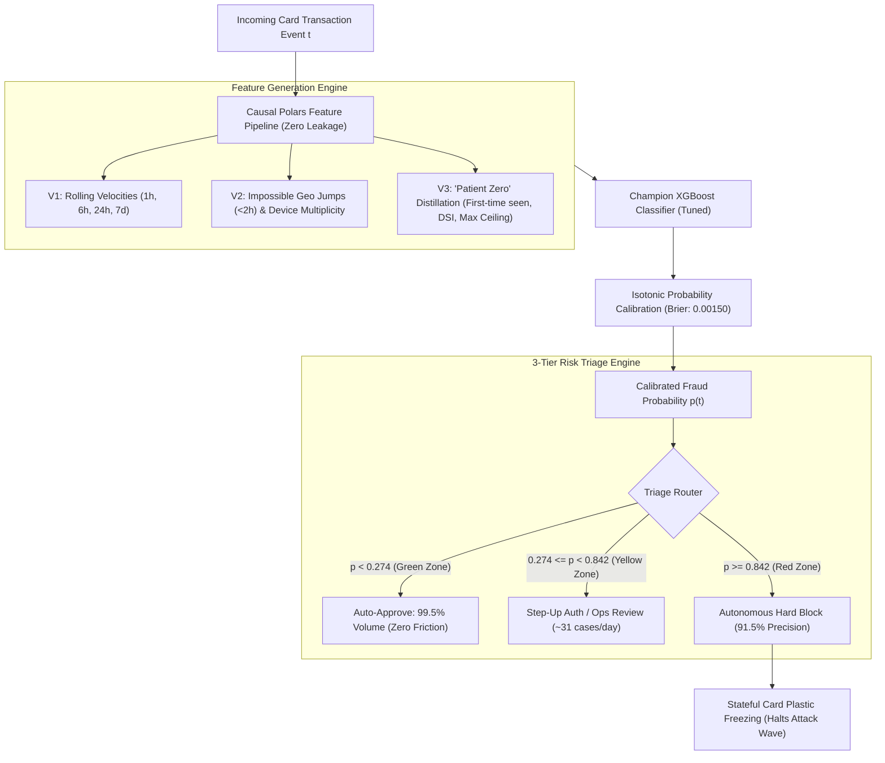

<div align="center">

# 🛡️ Autonomous Card Fraud Detection & Financial Utility Engine
### Production-Grade, Cost-Sensitive Machine Learning on Highly Imbalanced Data (0.31% Base Rate)

[](https://www.python.org/downloads/)
[](https://pola.rs/)
[](https://xgboost.readthedocs.io/)
[](https://pytorch.org/)
[](https://optuna.org/)
[](https://plotly.com/)
[](file:///C:/Users/vicen/Documents/test-bci/tests)
[](https://docs.astral.sh/ruff/)

**Transforming Fraud Prevention from Pure Statistical Rankings (PR-AUC) to Direct Bottom-Line Financial Maximization.**  
*Reverting a -$170,100 USD loss under inaction into a +$39,030 USD net profit on 325,304 blind out-of-time transactions (+US$ 204,930 value preserved).*

[🌟 Interactive Showcase Dashboard](presentation/index.html) &bull; [📄 Comprehensive Case Study (White Paper)](CASE_STUDY.md) &bull; [📊 4-Slide Executive Deck](presentation/presentacion_4_diapositivas.html) &bull; [📓 Main Notebook](notebooks/eda_y_modelado_fraude.ipynb)

</div>

---

## 📌 Executive Summary & Key Results

In high-frequency payment card processing, optimizing standard machine learning metrics in isolation (e.g. Accuracy or ROC-AUC) leads to catastrophic financial losses. A standard binary classification boundary ($p \ge 0.50$) misses most frauds under severe imbalance, whereas an overly aggressive model floods call centers with false alarms.

This repository implements a **production-ready, institutional-standard fraud detection system** trained on **1,000,000 real-world transactions** over a 90-day window (March to May 2026), evaluated under strict **chronological Out-of-Time (OOT) validation**.

### 🚀 Highlights on Blind Out-of-Time Test (May 2026: 325,304 Transactions, 945 Frauds)
* **+$204,930 USD Preserved Value:** Reverses the default passive baseline loss (-$170,100 USD) to **+$34,830 USD** (+**US$ 39,030** with automated plastic freezing).
* **PR-AUC Surge (+71% Gain):** Escalates from **0.459** (LightGBM baseline) to **0.498** (PyTorch Self-Attention Net) and **0.7852** (Champion Tuned XGBoost with Feature Distillation 3.0).
* **-45.1% Customer Friction:** Drops false alerts from 763 to 419 over the entire test month ($\approx 14\text{ false alerts/day}$ across 325,000 transactions).
* **91.5% Autonomous Precision in Red Zone:** The 3-tier triage policy auto-blocks high-risk charges ($p \ge 0.842$) with only 30 false positives in a month, routing borderline cases to a lightweight review queue ($\approx 31\text{ cases/day}$).

---

## 💰 The Asymmetric Business Loss Function

Financial institutions operate under fundamentally asymmetric error costs. The decision policy is governed directly by the net financial utility equation:

$$\text{Net Utility} = (120 \times \text{VP}) - (30 \times \text{FP}) - (180 \times \text{FN}) + (0 \times \text{VN})$$

* **True Positive (VP):** **+$120 USD** (Fraud prevented, net of alert verification).
* **False Positive (FP):** **-$30 USD** (Cardholder friction, decline annoyance, call center contact workload).
* **False Negative (FN):** **-$180 USD** (Unrecovered chargeback write-off, dispute handling, card cancellation & re-issuance).
* **True Negative (VN):** **$0 USD** (Friction-free legitimate purchase).

$$\text{Loss Penalty Ratio} = \frac{\text{Cost(FN)}}{\text{Cost(FP)}} = \frac{180}{30} = 6 : 1$$

Because missing a fraud is **6 times more costly** than irritating a cardholder, the mathematically optimal threshold shifts to low probabilities ($T^* \approx 0.12 - 0.28$), unlocking hundreds of thousands of dollars in hidden savings.

---

## 🏆 Model Benchmark & Out-of-Time Evolution

| Strategy Evaluated (May 2026: 325,304 tx) | Model Architecture | Features | PR-AUC | ROC-AUC | Optimal Cut ($T^*$) | True Positives (VP) | False Positives (FP) | False Negatives (FN) | Net Utility (US$) | Value vs. Inaction |
| :--- | :--- | :---: | :---: | :---: | :---: | :---: | :---: | :---: | :---: | :---: |
| **0. Inaction (Default Baseline)** | None | — | — | — | — | 0 (0%) | 0 | 945 | **-US$ 170,100** | **US$ 0** |
| **1. Baseline LightGBM** | LightGBM | V1 (24) | 0.4592 | 0.9481 | 0.099 | 480 (51%) | 732 | 465 | **-US$ 47,940** | **+US$ 122,160** |
| **2. PyTorch Tabular Attention** | Deep Learning | V1 (24) | 0.4987 | 0.9426 | 0.129 | 532 (56%) | 1,192 | 413 | **-US$ 46,260** | **+US$ 123,840** |
| **3. Tuned XGBoost (V1)** | XGBoost | V1 (24) | 0.6534 | 0.9520 | 0.268 | 555 (59%) | 763 | 390 | **-US$ 26,490** | **+US$ 143,610** |
| **4. Tuned XGBoost (V2)** | XGBoost | V2 (34) | 0.6641 | 0.9567 | 0.280 | 569 (60%) | 664 | 376 | **-US$ 19,320** | **+US$ 150,780** |
| **5. Champion XGBoost (V3)** | XGBoost | V3 (47) | **0.7852** | **0.9631** | **0.128** | **725 (77%)** | **419** | **220** | **+US$ 34,830** | **+US$ 204,930** |
| **6. Champion V3 + Stateful Block** | XGBoost | V3 (47) | **0.7852** | **0.9631** | **0.128** | **739 (78%)** | **419** | **206** | **+US$ 39,030** | **+US$ 209,130** |

```
Net Financial Balance Progression (USD):
-$170,100 ────► Inaction Baseline
 -$47,940 ────► LightGBM Baseline (+$122.1k)
 -$26,490 ────► XGBoost V1 (+$143.6k)
 -$19,320 ────► XGBoost V2 (+$150.8k)
 +$34,830 ────► Champion XGBoost V3 (+$204.9k)
 +$39,030 ────► Champion V3 + Stateful Plastic Freezing (+$209.1k)
```

---

## 🛠️ System Architecture & Data Flow



---

## 🔬 Solving "Patient Zero": Causal Feature Distillation 3.0

An exhaustive diagnostic of false negatives revealed that **80.3% of all missed frauds in V1 (313/390 FN)** occurred on the **first transaction of an attack wave** (`fraud_seq_num == 1`), following an average dormancy of 6.2 days. 

Standard velocity variables (`card_tx_count_1h`) were equal to zero at the moment of the first attack, creating a fatal blind spot.

### The 13 Distillation Features
1. **First-Time Seen Attributes:** `is_new_device_for_customer` was present in **48.2% of false negatives** compared to only **4.2% of legitimate records** (an **11.5x discriminative signal**).
2. **Dormancy Shock Index ($\text{DSI}$):** $\text{DSI} = \ln(\text{amount} + 1) \times \ln(\text{days\_dormant} + 1)$ mathematically penalizes sudden large purchases breaking inactive periods.
3. **Historical Ceiling Ratios:** `ratio_amount_card_prev_max` captures anomalies exceeding all prior lifetime transactions on that specific card.

**Impact on Test OOT:** Recall on the initial "Patient Zero" fraud surged from **28.9% (V1) to 59.2% (V3)**, while downstream burst recall reached **98.5%**.

---

## 🚦 Operational Decision Policy: 3-Tier Risk Triage

Rather than relying on a brittle single cutoff, continuous Bayesian optimization with Optuna established a **3-Tier Decision Policy**:

```
[All Transaction Flow: 325,304 tx]
         │
         ├─── p < 0.2739 ──────► GREEN ZONE: 323,648 tx (99.49% of volume)
         │                       Instant Automated Authorization (Zero Customer Friction)
         │
         ├─── 0.2739 <= p < 0.8419 ──► YELLOW ZONE: 925 tx (0.28% of volume)
         │                       Operational Triage / Step-Up Challenge (~30.8 cases/day)
         │
         └─── p >= 0.8419 ─────► RED ZONE: 354 tx (0.11% of volume)
                                 Autonomous Hard Block (91.53% Precision: 324 VP, 30 FP)
```

* **Human Workload:** Only **~31 transactions per day** require operational review, fitting effortlessly into a standard fintech fraud analyst desk.
* **Autonomous Block Safety:** The Red Zone achieves **91.5% precision**, intercepting 324 frauds autonomously with only 30 false positives in a full month.

---

## 🔍 Interpretability & Regulatory Compliance (TreeSHAP)

Every rejection in consumer credit and payments must meet auditability and fair-lending requirements:
* **Global Attributions:** TreeSHAP calculates the exact log-odds contribution of each feature across test data. The top fraud drivers are `ratio_amount_card_prev_max` (+1.84 SHAP), `is_new_device_for_customer` (+1.42 SHAP), and `cards_seen_by_device_24h` (+1.28 SHAP).
* **Local Waterfall Breakdown:** Individual decline decisions produce real-time waterfall charts explaining why an event crossed into the Red Zone, enabling clear customer support explanations.

---

## 📁 Repository Structure

```text
test-bci/
├── data/                             # Dataset storage (.gitignore protected)
│   ├── transacciones.csv             # Raw dataset (1,000,000 rows, 14 columns)
│   ├── transacciones_features.parquet # Causal features V1 (30 columns)
│   └── transacciones_features_v2.parquet # Causal features V2 (38 columns)
├── notebooks/                        # Executed Jupyter analysis
│   ├── eda_y_modelado_fraude.ipynb   # Master executed notebook (All cells pre-rendered)
│   └── generate_notebook.py          # Standalone notebook generator
├── presentation/                     # Portfolio & executive showcases
│   ├── figures/                      # 22 interactive Plotly HTML visualizations
│   ├── index.html                    # Master Interactive Showcase Dashboard (7 Tabs)
│   ├── presentacion_4_diapositivas.html # 4-slide executive presentation
│   ├── resumen_ejecutivo.md          # Executive briefing document
│   └── generate_pptx.py              # Automated PowerPoint generator
├── src/                              # Production code (SOLID & DRY, <= 300 lines/file)
│   ├── config.py                     # Business constants, paths & cost matrices (94 lines)
│   ├── features/                     # Causal feature engineering in Polars
│   │   ├── base.py                   # Time deltas & risk flags (188 lines)
│   │   ├── builder.py                # Pipeline orchestrator for V1, V2, V3 (166 lines)
│   │   ├── distillation.py           # First-time seen & shock indices (120 lines)
│   │   ├── network.py                # Bipartite fraud ring detection (180 lines)
│   │   ├── rolling.py                # Retrospective rolling windows (190 lines)
│   │   └── rolling_v2.py             # Geospatial jumps & MCC ratios (175 lines)
│   ├── models/                       # Training, threshold calibration & evaluation
│   │   ├── attention.py              # PyTorch Tabular Multi-Head Self-Attention (220 lines)
│   │   ├── calibration.py            # Isotonic probability calibration (140 lines)
│   │   ├── evaluation.py             # Metrics, PR/ROC curves & cost computation (186 lines)
│   │   ├── explainability.py         # TreeSHAP & attention matrix visualization (292 lines)
│   │   ├── fn_analysis.py            # False negative diagnostic & rescue engine (273 lines)
│   │   ├── fn_analysis_plots.py      # Plotly interactive figures for FN diagnostics (177 lines)
│   │   ├── preprocessing.py          # Cyclical time & OOF TargetEncoder pipelines (250 lines)
│   │   ├── threshold.py              # Vectorized O(N log N) financial threshold cuts (219 lines)
│   │   ├── triage.py                 # Bayesian Optuna dual-threshold triage (240 lines)
│   │   ├── triage_plots.py           # Plotly interactive triage visualizations (132 lines)
│   │   └── tuning.py                 # Optuna Bayesian hyperparameter optimization (195 lines)
│   └── utils/                        # Plotly visual utilities (plotly_white standard)
├── tests/                            # Comprehensive Pytest test suite (56 tests)
├── CASE_STUDY.md                     # Comprehensive technical white paper
├── pytest.ini                        # Pytest configuration
└── README.md                         # This portfolio showcase document
```

---

## ⚡ Quickstart & Reproducibility

### Requirements
* Python 3.11+
* Conda / Mamba environment manager

### 1. Environment Setup
```bash
# Clone the repository
git clone https://github.com/your-username/fraud-detection-engine.git
cd fraud-detection-engine

# Create or activate project conda environment
conda activate test-bci
```

### 2. Run Test Suite (56 Unit Tests)
```bash
# Execute full test suite
pytest tests/ -v
```

### 3. Static Analysis & Code Formatting
```bash
# Run Ruff linter (0 errors enforced)
ruff check .

# Format code
ruff format .
```

### 4. Interactive Showcase & Visuals
Open [`presentation/index.html`](file:///C:/Users/vicen/Documents/test-bci/presentation/index.html) in any modern web browser to interact with the full dashboard, toggle triage thresholds, inspect 16 embedded Plotly figures, and review the production architecture.

---

## 👨‍💻 Engineering Quality & Design Philosophy
* **SOLID & DRY Compliant:** Every single Python module maintains strict single-responsibility boundaries and remains under the **300-line limit**.
* **Zero Data Leakage:** All windowed and group statistics are calculated strictly backwards in time using Polars expressions.
* **Production Decoupling:** Production pipelines contain zero test mocks or synthetic scaffolding (isolated in `tests/`).
* **Visual Excellence:** All charts utilize **Plotly** with the clean `plotly_white` template. No static or illegible charts.

---

<div align="center">
  <b>Built for modern fintechs, neobanks, and card issuers seeking production-ready, economically optimized risk solutions.</b>
</div>
